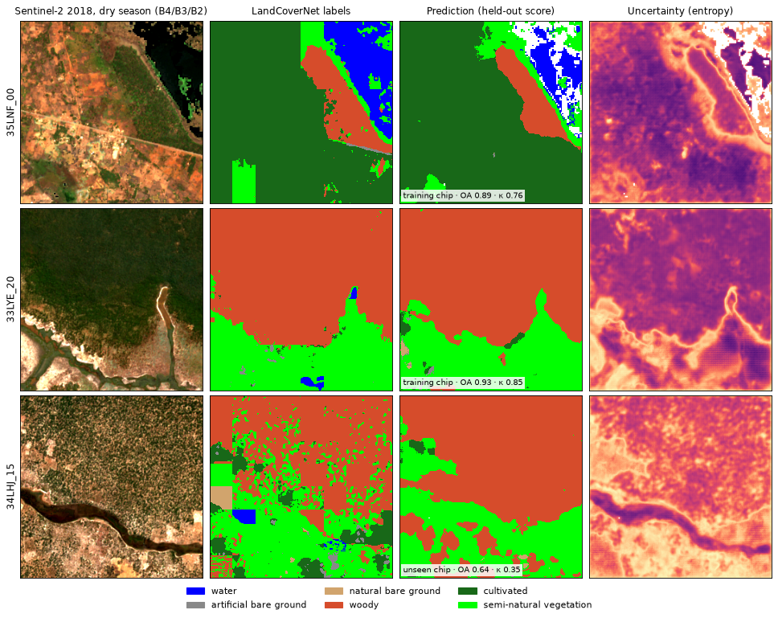

# EOForge

Run ready-made deep learning models on your own Earth observation imagery, look at the result on a map, and train or fine-tune your own models on the same imagery.

- **Model zoo and web app.** Land cover (Dynamic World, TerraMind), field boundaries (Fields of The World, Delineate Anything), floods and burn scars (Prithvi-EO-2.0), clouds (OmniCloudMask) and object outlines (SAM 2). Pick a GeoTIFF and a model in a local web app, run it on your GPU, and get GeoTIFFs, polygons, area statistics and a per-pixel uncertainty map.
- **Bring a model.** Add a model you come across with a short YAML model card, or an ONNX file from the app.
- **Train your own.** One YAML file describes imagery, labels (polygons, points or a label raster), architecture (built-in U-Net, any timm encoder, or your own PyTorch file) and training. Validation uses spatial blocks or whole held-out images, so scores are not inflated by neighbouring pixels.



## Install

Linux or WSL with Python 3.10+ and, ideally, an NVIDIA GPU:

```bash
git clone https://github.com/<you>/eoforge.git && cd eoforge
bash install.sh                      # creates ./.venv, installs PyTorch, EOForge, all models and their weights (~4 GB)
source .venv/bin/activate
```

`install.sh` installs PyTorch 2.14 built for CUDA 12.6, the last build that still supports GTX 10xx (Pascal) cards. For newer GPUs: `TORCH_CUDA=cu128 bash install.sh`. Without a GPU everything runs on the CPU, more slowly. `SKIP_DOWNLOAD=1` skips the weight download; `eoforge zoo download` fetches the weights later, `eoforge zoo status` shows what is ready.

## Quick start

```bash
eoforge app --folder /path/to/your/images      # web app: open http://localhost:8501
eoforge zoo list                               # all models
eoforge zoo run dynamic-world scene.tif        # one model from the command line
```

Results go to `<image folder>/eoforge_results/<image>__<model>/`: `classes.tif` (or `objects.tif`), `entropy.tif`, `fields.gpkg` for the field models, `summary.json` with class areas, and map previews.

## Tutorial with public data

```bash
python tools/get_tutorial_data.py        # Sentinel-2 L2A (4 dates), ESA WorldCover, Sen1Floods11 chips; ~70 MB, no account
```

Then follow `tutorial/TUTORIAL.md`: one step per model, and `tools/compare_maps.py` to compare a result with a reference map. The default area is farmland and miombo woodland north of Lusaka, Zambia; `--lat --lon --year` picks your own.

## Models

| Id | What it does | Input |
|---|---|---|
| `dynamic-world` | Google Dynamic World land cover, 9 classes (ONNX, included) | Sentinel-2 **L1C**, 9 bands, 10 m |
| `terramind-lulc` | TerraMind generated land cover, Esri classes | Sentinel-2 L2A, 12 bands |
| `ftw-fields`, `ftw-fields-fast`, `ftw-fields-1date` | Fields of The World: field, boundary, background, plus field polygons | Sentinel-2 L2A, R G B NIR, two dates (or one) |
| `delineate-anything`, `delineate-anything-small` | one polygon per field | RGB, 0.25-10 m |
| `prithvi-floods` | Prithvi-EO-2.0 water and floods (Sen1Floods11) | Sentinel-2 L1C, 6 bands |
| `prithvi-burnscars` | Prithvi-EO-2.0 burned areas | HLS, 6 bands, 30 m |
| `omnicloudmask` | clear, thick cloud, thin cloud, shadow | red, green, NIR, 10-50 m |
| `sam2` | Segment Anything 2 object outlines | any RGB, best < 2 m |
| `trained-<run>` | every model you trained with EOForge | as trained |

Before a model runs, the input is checked: 0-1 reflectance is scaled to x10000, `--offset 1000` removes the +1000 offset in Sentinel-2 data processed since January 2022 (you get a warning when the data look like they carry it), `--match-resolution` resamples to the model's pixel size, unnamed bands are read in Sentinel-2 order, and missing bands get stand-ins (e.g. B08 for B8A) with a warning.

Which data suit each model, with test sets that have reference labels: [docs/vault/Guides/Sample datasets per model.md](docs/vault/Guides/Sample%20datasets%20per%20model.md).

## Adding a model

A model card is a short YAML file in `~/.eoforge/models/` (or `./models/`, or a folder in `$EOFORGE_MODELS`): bands, classes and colours, normalisation, weights (a path, a URL or a Hugging Face repo) and which adapter runs it. The built-in cards in `eoforge/zoo/cards/` are examples. ONNX models can be added from the app's *Add a model* tab. See [Model zoo and app](docs/vault/Guides/Model%20zoo%20and%20app.md).

## Training your own model

```bash
eoforge demo --out demo                  # synthetic scene and labels
eoforge train configs/demo_unet.yaml     # train, validate on held-out blocks, map the scene
eoforge predict runs/demo_unet/best.pt demo/scene_other.tif --out pred_other
eoforge export runs/demo_unet/best.pt --out model.onnx
```

```yaml
data:   {source: local, path: s2_2023.tif, bands: [2, 3, 4, 8, 11, 12]}
labels: {path: training.gpkg, class_field: lc_class, classes: [water, grassland, woodland, cropland]}
model:  {arch: unet}                     # or timm:resnet18, or path/to/my_model.py:build
train:  {epochs: 40, block_size: 128}
```

A model trained on one image has seen one place and one date and rarely transfers. List several images and hold whole images out to measure transfer honestly:

```yaml
scenes:
  - {name: a, image: a.tif, labels: a_labels.tif}
  - {name: b, image: b.tif, labels: b_labels.gpkg}
  - {name: c, image: c.tif, labels: c_labels.tif}
train: {val_scenes: [c]}
```

Training samples chips evenly across classes, flips, rotates and jitters band brightness, and keeps the epoch with the lowest validation loss. `metrics.json` has overall accuracy, kappa, per-class F1 and the confusion matrix on held-out pixels. `examples/my_model.py` shows the architecture contract: `build(in_channels, num_classes, **params)` returns an `nn.Module` mapping `(B, C, H, W)` to logits `(B, K, H, W)`. Fine-tuning: `model.weights: runs/old/best.pt`, `model.freeze_encoder: true`.

LandCoverNet Africa, ten chips, one model across them:

```bash
python tools/fetch_landcovernet.py --n 10 --out showcase/landcovernet
python tools/run_showcase.py showcase/landcovernet --pooled --holdout 3
```

## Documentation

`docs/vault` is an [Obsidian](https://obsidian.md) vault (plain Markdown, also readable on GitHub). It covers guides, every module and function, concepts (validation, normalisation, uncertainty, band shift), test reports and the changelog. Start at [00 Home](docs/vault/00%20Home.md).

## Project layout

```
eoforge/            the package
  config.py           YAML schema (unknown keys are errors)
  data/               reading imagery, labels, spatial split, chip sampling
  models/             architecture registry, U-Net, FCN, timm encoders
  pipeline.py         train, predict, export
  predict.py          tiled inference, GeoTIFF writers
  zoo/                model cards, adapters, runner, previews
  app/                Streamlit web app
configs/            example training configs
examples/           your-own-architecture example, real-data test
tools/              tutorial data, LandCoverNet showcase, map comparison, Dynamic World conversion
runs/example_unet_33LYE_20/   a small trained example model
docs/vault/         documentation
```

## Licence

MIT, see [LICENSE](LICENSE). Model weights downloaded on first use keep their own licences; Delineate Anything (weights and ultralytics) is AGPL-3.0. See [THIRD_PARTY_NOTICES.md](THIRD_PARTY_NOTICES.md). Please cite the models and datasets you use.
