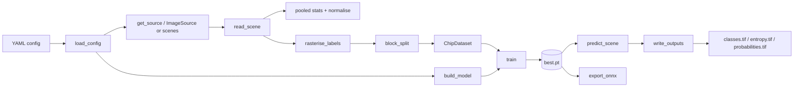
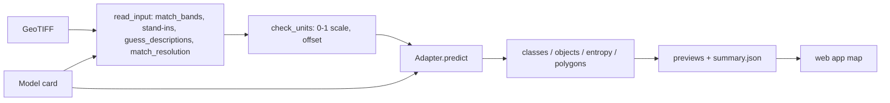

# EOForge

Run ready-made deep learning models on your Earth observation imagery and see the result on a map, add models when you come across them, and train or fine-tune your own, with georeferenced maps and per-pixel uncertainty.

![[landcovernet_pooled_examples.png]]

## Start here
- [[Quickstart]]: install, run the demo, run on your own data
- [[Model zoo and app]]: run ready-made models in the browser, add new ones
- [[Tutorial]]: public sample data for every model, with steps
- [[Sample datasets per model]]: which data each model needs, test sets with labels
- [[Config reference]]: every YAML key
- [[Bring your own model]]: plug in an architecture
- [[LandCoverNet showcase]]: download 10 African chips, train per chip or one model for all
- [[Fine-tuning]]: start from a checkpoint, freeze the encoder

## How the pipeline flows

## How a zoo run flows

## Modules
| Module | Role |
|---|---|
| [[eoforge.config]] | YAML schema and loading |
| [[eoforge.data.sources]] | Where imagery comes from (local now, STAC and GEE next) |
| [[eoforge.data.raster]] | Reading imagery, normalisation, label rasterisation |
| [[eoforge.data.dataset]] | Spatial train/val split and chip sampling |
| [[eoforge.models.registry]] | Turning `model.arch` into a network |
| [[eoforge.models.builtin]] | Built-in U-Net and FCN |
| [[eoforge.models.timm_seg]] | Any timm encoder with a decoder |
| [[eoforge.pipeline]] | `train`, `predict`, `export_onnx` |
| [[eoforge.predict]] | Tiled inference and GeoTIFF writing |
| [[eoforge.metrics]] | Confusion matrix and accuracy metrics |
| [[eoforge.cli]] | The `eoforge` command |
| [[eoforge.demo]] | Synthetic demo data |
| [[eoforge.zoo]] | Ready-made models: cards, adapters, runner |
| [[eoforge.app]] | The web app |

## Concepts
[[Model card]] · [[Adapter]] · [[Model contract]] · [[Spatial block validation]] · [[Normalisation]] · [[Class balancing]] · [[Tiled inference]] · [[Entropy as uncertainty]] · [[Checkpoint format]] · [[Band shift]] · [[Checkpoint selection]]

## Tests
- [[LandCoverNet showcase]] (run on your GPU) · [[Test - LandCoverNet showcase run 1]] · [[Test - LandCoverNet pooled run]]
- [[Test - Tutorial Zambia]]
- [[Test - Synthetic demo]]
- [[Test - Real Sentinel-2 Slovenia]]
- [[Review - generalisation 0.6.0]]

## Project
[[Roadmap]] · [[Changelog]] · Licence: MIT (`LICENSE`, `THIRD_PARTY_NOTICES.md` in the repository)
